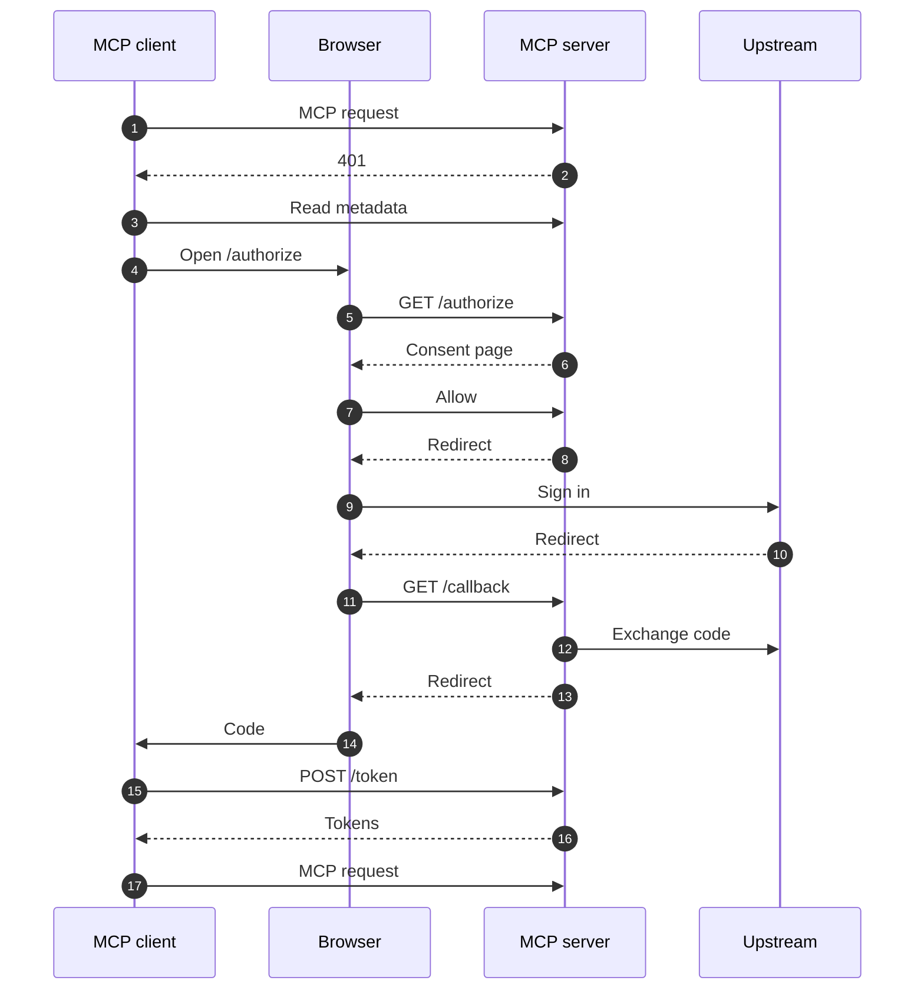
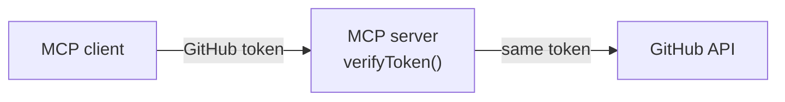
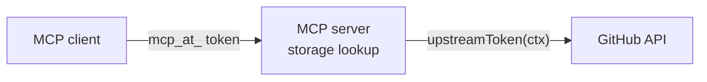

Use `oauthProxy` when your identity provider gives you one fixed `clientId` and `clientSecret` and cannot register MCP clients itself. GitHub and Google work this way. With `oauthProxy`, your MCP server becomes its own OAuth authorization server for MCP clients, and signs users in to the upstream provider as one ordinary OAuth app.

The upstream client secret and the user's upstream tokens stay on your server. MCP clients only receive tokens that your server issues. Tools call the upstream API as the user with `upstreamToken(ctx)`.

If your provider supports Dynamic Client Registration (DCR), use a [built-in provider](/v2/typescript/server/authentication/index) or a [Custom Provider](/v2/typescript/server/authentication/providers/custom) instead. Those keep your server a resource server only.

## How the proxy works

The proxy sits between two OAuth relationships. Toward MCP clients, it is the authorization server: it identifies clients, shows a consent page, and issues its own access and refresh tokens. Toward the upstream provider, it is a confidential OAuth client with one registered callback URL.

| Who holds it                | Credential                                                                                   |
| --------------------------- | -------------------------------------------------------------------------------------------- |
| MCP client                  | The proxy's access token (`mcp_at_…`) and refresh token (`mcp_rt_…`)                         |
| Your server's storage       | Clients, sign-in state, grants, and the upstream tokens, all encrypted with your `secret`    |
| Your server's configuration | The upstream `clientId` and `clientSecret`                                                   |
| Upstream provider           | The single callback URL `https://<your server>/mcp/oauth/callback`                           |

### The sign-in flow



1. The client calls the MCP endpoint without a token.
2. The server answers 401 with the URL of its protected resource metadata.
3. The metadata names the server itself as the authorization server and lists its `/mcp/oauth/*` endpoints. The client identifies itself with a client ID metadata document URL, or registers at `/mcp/oauth/register`.
4. The client opens `/mcp/oauth/authorize` in the browser with its PKCE challenge and `state`.
5. The proxy checks the client, the redirect URI, the PKCE challenge, and the RFC 8707 `resource`.
6. The proxy shows its consent page.
7. The user approves.
8. The proxy redirects the browser to the upstream provider with the proxy's own `client_id` and its own PKCE challenge.
9. The user signs in to the upstream provider and approves the OAuth app.
10. The upstream provider redirects the browser to `/mcp/oauth/callback` with a code.
11. The proxy checks that the callback belongs to the browser that approved consent, using a signed cookie.
12. The proxy exchanges the code on the server with the client secret and its PKCE verifier, then reads the user, for example from Google's userinfo endpoint.
13. The proxy redirects the browser to the client's redirect URI with a one-time code and the client's original `state`.
14. The client receives the code.
15. The client exchanges the code at `/mcp/oauth/token` with its PKCE verifier.
16. The proxy returns its own access token (`mcp_at_…`) and refresh token (`mcp_rt_…`).
17. The client calls the MCP endpoint with the access token. The proxy looks up the grant and refreshes the upstream token if it expires soon.

The proxy runs its own PKCE round with the upstream provider, so an intercepted upstream authorization code is useless to anyone but the proxy.

## Set up a Google sign-in

<Steps>
  <Step title="Configure the Google Auth Platform">
    In the [Google Cloud console](https://console.cloud.google.com/auth/overview), open **Google Auth Platform** for your project and set up the app's branding and audience. While the publishing status is **Testing**, add each Google account that signs in under **Audience** > **Test users**.
  </Step>
  <Step title="Create an OAuth client">
    Under **Clients**, create a client of type **Web application**. Add the proxy's callback as an **Authorized redirect URI**: `http://localhost:3000/mcp/oauth/callback` for local development. Google never sees the MCP client's own redirect URI, so this one URL serves every client. Copy the client ID and the client secret.
  </Step>
  <Step title="Set the environment">
    ```bash .env
    # The OAuth client from the previous step.
    GOOGLE_CLIENT_ID=
    GOOGLE_CLIENT_SECRET=
    # At least 32 characters. Generate one with: openssl rand -base64 32
    MCP_USE_OAUTH_SECRET=
    ```
  </Step>
  <Step title="Configure the server">
    ```typescript src/index.ts
    import { MCPServer } from "mcp-use";
    import { google, memoryStorage, oauthProxy } from "mcp-use/oauth";

    const server = new MCPServer({
      name: "google-tools",
      version: "1.0.0",
      oauth: oauthProxy({
        upstream: google({
          clientId: process.env.GOOGLE_CLIENT_ID!,
          clientSecret: process.env.GOOGLE_CLIENT_SECRET!,
        }),
        // The secret defaults to MCP_USE_OAUTH_SECRET.
        // memoryStorage() works on localhost only. See "Choose storage" below.
        storage: memoryStorage(),
      }),
    });

    server.tool(
      { name: "whoami", description: "Return the signed-in Google account." },
      async (_input, ctx) => {
        // The profile holds the fields of Google's userinfo response.
        const { name, email } = ctx.auth.user.profile;
        return { content: [{ type: "text", text: `${String(name)} <${String(email)}>` }] };
      },
    );

    export default server;
    ```
  </Step>
  <Step title="Connect a client">
    Run `mcp-use dev` and connect a client to `http://localhost:3000/mcp`:

    ```bash
    claude mcp add --transport http google-tools http://localhost:3000/mcp
    ```

    The client opens the consent page, then Google. After sign-in, call `whoami`.
  </Step>
</Steps>

The complete [Google example](https://github.com/mcp-use/mcp-use/tree/main/libraries/typescript/packages/server/examples/auth/oauth-proxy-firebase) keeps sign-ins in Firestore with `firestoreStorage` and stores each user's notes under their Google subject.

## Register the callback URL

Register exactly one callback URL with the upstream provider:

```text
<public origin><basePath>/oauth/callback
```

With the default `basePath` of `/mcp`, that is `https://mcp.example.com/mcp/oauth/callback` in production and `http://localhost:3000/mcp/oauth/callback` locally. 

The proxy serves all of its endpoints under `<basePath>/oauth/`:

| Endpoint                   | Method | Purpose                                                        |
| -------------------------- | ------ | -------------------------------------------------------------- |
| `/mcp/oauth/authorize`     | `GET`  | Validates the request and shows the consent page               |
| `/mcp/oauth/consent`       | `POST` | Records the consent decision and redirects upstream            |
| `/mcp/oauth/callback`      | `GET`  | Receives the upstream code and redirects back to the client    |
| `/mcp/oauth/token`         | `POST` | Authorization-code and refresh-token grants                    |
| `/mcp/oauth/revoke`        | `POST` | RFC 7009 token revocation; ends the whole sign-in              |
| `/mcp/oauth/register`      | `POST` | RFC 7591 dynamic client registration, only while `dcr` is on   |

The server publishes protected resource metadata that names itself as the authorization server, and RFC 8414 authorization server metadata that lists these endpoints. You do not configure either by hand.

## Use the upstream token in tools

`upstreamToken(ctx)` returns the upstream access token for the signed-in user. It throws when the request is not signed in through `oauthProxy`, so a tool never calls the upstream API without the user's token.

This tool lists the user's next Google Calendar events. Enable the Google Calendar API in the Google Cloud project, and request its scope from Google:

```typescript
upstream: google({
  clientId: process.env.GOOGLE_CLIENT_ID!,
  clientSecret: process.env.GOOGLE_CLIENT_SECRET!,
  scopes: ["email", "profile", "https://www.googleapis.com/auth/calendar.readonly"],
}),
```

Then call the Calendar API with the user's Google token:

```typescript
import { upstreamToken } from "mcp-use/oauth";

server.tool(
  { name: "upcoming-events", description: "List the user's next 10 calendar events." },
  async (_input, ctx) => {
    const params = new URLSearchParams({
      timeMin: new Date().toISOString(),
      maxResults: "10",
      singleEvents: "true",
      orderBy: "startTime",
    });
    const response = await fetch(
      `https://www.googleapis.com/calendar/v3/calendars/primary/events?${params}`,
      { headers: { authorization: `Bearer ${upstreamToken(ctx)}` } },
    );
    if (!response.ok) throw new Error(`Google Calendar returned ${response.status}`);
    const { items } = (await response.json()) as {
      items: { summary?: string; start: { dateTime?: string; date?: string } }[];
    };
    const lines = items.map(
      (event) => `${event.start.dateTime ?? event.start.date} ${event.summary ?? "(no title)"}`,
    );
    return { content: [{ type: "text", text: lines.join("\n") || "No upcoming events." }] };
  },
);
```

Keep the upstream token on the server. Do not return it in tool results, views, or `_meta`.

`ctx.auth` on a proxy server contains:

| Field                   | Value                                                                                   |
| ----------------------- | --------------------------------------------------------------------------------------- |
| `ctx.auth.user`         | The `UpstreamUser` `{ subject, profile }`, or the result of `mapUser`                   |
| `ctx.auth.upstream`     | `{ accessToken, scopes, expiresAt? }` for the upstream provider                         |
| `ctx.auth.accessToken`  | The proxy's own `mcp_at_…` token, not the upstream token                                |
| `ctx.auth.clientId`     | The MCP client's ID: a metadata document URL, or `mcp_client_…` for a registered client |
| `ctx.auth.scopes`       | The proxy scopes granted to this sign-in                                                |
| `ctx.auth.payload`      | `{ sub, client_id, scope, provider, profile }`                                          |
| `ctx.auth.permissions`  | Always `[]`. Derive permissions in `mapUser` or in your tools                           |

`subject` is the provider's stable user ID: the OpenID Connect `sub` for Google, or the numeric user ID for GitHub. It is never an email address or a login name, which can change. Use `subject` as the key for any data you store per user.

### Map the user

Pass `mapUser` to shape `ctx.auth.user`, for example to match the `id` field that the other providers use:

```typescript
oauthProxy({
  upstream: google({ clientId, clientSecret }),
  mapUser: (user) => ({
    id: user.subject,
    email: typeof user.profile.email === "string" ? user.profile.email : undefined,
    emailVerified: user.profile.email_verified === true,
  }),
});
```

`mapUser` runs on every request. It controls the user shape, not who can sign in: any user of the upstream provider can complete the sign-in. To restrict users, throw from your tools, or check `ctx.auth.user` in [middleware](/v2/typescript/server/middleware).

## Choose an upstream provider

| Upstream                  | Function     | Subject                     | Profile fields                                           |
| ------------------------- | ------------ | --------------------------- | -------------------------------------------------------- |
| Google                    | `google()`   | OpenID Connect `sub`        | `sub`, `email`, `email_verified`, `name`, `picture`, `hd` |
| GitHub and GitHub Enterprise Server | `github()`   | Numeric GitHub user ID      | `id`, `login`, `name`, `email`, `avatar_url`             |
| Any OAuth 2.0 provider    | `upstream()` | What your `fetchUser` returns | What your `fetchUser` returns                          |

### Google

`google()` always requests `openid` and, by default, `email` and `profile`. Add Google API scopes to `scopes` as your tools need them.

`google()` requests offline access, so Google returns a refresh token and the proxy refreshes Google tokens on the server. If Google returns no refresh token and none is stored for the user, the proxy sends the user through Google consent once more.

While the app's publishing status is **Testing**, Google expires refresh tokens after 7 days unless the app requests only the `openid`, `email`, and `profile` scopes. Users then sign in again. Publish the app to remove the limit.

### GitHub

In [GitHub Developer settings](https://github.com/settings/developers), choose **OAuth Apps** > **New OAuth App**, and set the callback URL to `<public origin>/mcp/oauth/callback`. Turn on **Expire user access tokens** so that GitHub issues refresh tokens; the proxy then refreshes the GitHub token on the server.

```typescript
import { github, oauthProxy } from "mcp-use/oauth";

oauthProxy({
  upstream: github({
    clientId: process.env.GITHUB_CLIENT_ID!,
    clientSecret: process.env.GITHUB_CLIENT_SECRET!,
    // Default: ["read:user"]. Add "repo" for private repositories.
    scopes: ["read:user"],
  }),
  storage,
});
```

For GitHub Enterprise Server, set `baseUrl` to the web host, and `apiUrl` when the REST API lives elsewhere. The [GitHub example](https://github.com/mcp-use/mcp-use/tree/main/libraries/typescript/packages/server/examples/auth/oauth-proxy-github) calls the GitHub API as the user with Octokit and keeps sign-ins in Redis.

### Any OAuth 2.0 provider

Use `upstream()` for a provider that has authorization and token endpoints. `fetchUser` reads the signed-in user with the upstream tokens and must return a stable `subject`.

```typescript
import { oauthProxy, upstream } from "mcp-use/oauth";

oauthProxy({
  upstream: upstream({
    id: "acme",
    name: "Acme",
    authorizationEndpoint: "https://id.acme.dev/oauth/authorize",
    tokenEndpoint: "https://id.acme.dev/oauth/token",
    clientId: process.env.ACME_CLIENT_ID!,
    clientSecret: process.env.ACME_CLIENT_SECRET!,
    scopes: ["profile"],
    fetchUser: async (tokens, fetch) => {
      const response = await fetch("https://api.acme.dev/me", {
        headers: { authorization: `Bearer ${tokens.accessToken}` },
      });
      if (!response.ok) throw new Error(`Acme /me returned ${response.status}`);
      const me = (await response.json()) as { id: string; email?: string };
      return { subject: String(me.id), profile: me };
    },
  }),
});
```

`id` appears in storage keys and `ctx.auth.payload.provider`; `name` appears on the consent page. Endpoints must use HTTPS (HTTP is accepted on localhost). PKCE is on by default; set `pkce: false` only for a provider that rejects it. Set `issuer` when the token endpoint returns OpenID Connect ID tokens, and `authorizeParams` for extra query parameters such as `prompt`.

## Choose storage

The proxy keeps clients, sign-in state, one-time codes, grants, and upstream tokens between requests, so it needs a store that every instance of the server shares. The proxy encrypts every value with your `secret` before the store sees it, and stores only SHA-256 hashes of tokens in keys.

```typescript
import { google, oauthProxy } from "mcp-use/oauth";
import { upstashStorage } from "mcp-use/oauth/storage";

oauthProxy({
  upstream: google({ clientId, clientSecret }),
  storage: upstashStorage({
    url: process.env.UPSTASH_REDIS_REST_URL!,
    token: process.env.UPSTASH_REDIS_REST_TOKEN!,
  }),
});
```

`mcp-use/oauth/storage` has adapters for Upstash, Redis, Postgres, Firestore, and Cloudflare D1 or Durable Objects. See [OAuth Proxy storage](/v2/typescript/server/authentication/providers/oauth-proxy-storage) to pick one or write your own.

### What each environment requires

| Where the server runs                                        | `storage`                 | `secret`                       |
| ------------------------------------------------------------ | ------------------------- | ------------------------------ |
| `listen()` on a localhost resource, bound to `127.0.0.1`, `localhost`, or `::1` | Optional (memory default) | Optional (random key per process) |
| `mcp-use dev` on localhost                                   | Required: pass `memoryStorage()` or a shared store | Required                     |
| Any other deployment, tunnel, or public URL                  | Required: a shared store  | Required                       |

`oauthProxy` throws when the server mounts without a required `storage` or `secret`. `memoryStorage()` is refused outside localhost. Without a secret, the proxy logs a warning and uses a random key, so sign-ins end when the process stops.

## Set and rotate the secret

The proxy derives its encryption and cookie keys from `secret`, which defaults to the `MCP_USE_OAUTH_SECRET` environment variable. Use a random string of at least 32 characters:

```bash
openssl rand -base64 32
```

To rotate, pass an array. The first secret encrypts and signs; the others still decrypt and verify:

```typescript
oauthProxy({
  upstream,
  storage,
  secret: [process.env.MCP_USE_OAUTH_SECRET!, process.env.MCP_USE_OAUTH_SECRET_PREVIOUS!],
});
```

Keep the previous secret until every record written with it has expired: 30 days for refresh tokens, 60 days for stored upstream tokens. Records that no secret can decrypt read as missing, so their users sign in again. The proxy logs a warning, once for each kind of record, with the key ID that wrote it.

## Restrict which clients connect

By default, any MCP client can connect. A client identifies itself in one of two ways:

- **Client ID metadata document (CIMD).** The client uses an HTTPS URL as its `client_id`, and the proxy fetches its metadata from that URL. The MCP specification prefers this. Claude and ChatGPT use it.
- **Dynamic client registration (DCR).** The client registers at `/mcp/oauth/register` and gets a `mcp_client_…` ID. Registered clients are public clients: the proxy never issues a client secret.

Set `clients` to allow only the apps you list. Dynamic client registration turns off while `clients` is set, because a registered client names itself.

```typescript
oauthProxy({
  upstream,
  storage,
  clients: [
    // One metadata document: exactly this client.
    "https://claude.ai/oauth/mcp-client-metadata.json",
    // An HTTPS origin: every metadata document on chatgpt.com.
    "https://chatgpt.com",
    // A client defined by hand, for a client that can use neither method.
    {
      clientId: "internal-cli",
      redirectUris: ["http://127.0.0.1/callback"],
      clientName: "Internal CLI",
    },
  ],
});
```

| `clients` entry                | Allows                                                                                       |
| ------------------------------ | -------------------------------------------------------------------------------------------- |
| Metadata document URL          | That one client                                                                              |
| HTTPS origin                   | Every metadata document on that origin. ChatGPT uses a different document URL per connector, so list `https://chatgpt.com` |
| `OAuthProxyClient` object      | A client with a fixed `clientId` and exact `redirectUris`. On loopback (`http://127.0.0.1`), any port matches |

<Warning>
  Removing a client from `clients`, or turning off `dcr`, ends that client's sign-ins for good. The next request with one of its tokens deletes the grant, and adding the client back does not restore it. A briefly wrong allowlist signs those users out.
</Warning>

`clients` controls which apps connect, not which users sign in. `dcr: true` together with `clients` throws.

The proxy fetches metadata documents only from hosts that resolve to public addresses. On Node.js and Bun it connects only to the addresses it checked. On Cloudflare Workers and Deno, `fetch` resolves the host again, so list the trusted metadata documents in `clients` to close the DNS-rebinding window there. Passing a custom `fetch` turns the host check off; your `fetch` must then enforce its own network policy.

## Configure the consent page

The proxy shows a consent page before it sends the user upstream. The page names your server by its domain, the app that asks, where the browser returns, the upstream provider, and the scopes. Consent defends against a malicious client that reuses an earlier upstream approval (a confused-deputy attack), so it is on by default.

| `consent` value           | Behavior                                                                                         |
| ------------------------- | ------------------------------------------------------------------------------------------------ |
| Omitted or `{ mode: "always" }` | Asks on every sign-in                                                                       |
| `{ mode: "remember" }`    | Asks once per browser for each client and HTTPS redirect URI, for 1 year. Loopback and custom-scheme redirects still ask every time, because any local program can claim them |
| `{ page: Component }`     | Renders your React component instead of the built-in page                                         |
| `false`                   | No consent page. Allowed only on localhost; refused on a `listen()` that binds beyond loopback   |

### Render a custom consent page

`consent.page` takes a React component that the proxy renders on the server with `react-dom/server`, so install `react` and `react-dom`. The component receives `ConsentPageProps` and must render a form that posts to `form.action` with a hidden `csrf` input and two `decision` buttons:

```tsx src/consent.tsx
import type { ConsentPageProps } from "mcp-use/oauth";

export function Consent({ client, serverHost, upstream, scopes, form }: ConsentPageProps) {
  return (
    <main>
      <h1>Allow {client.name ?? "this app"} to connect to {serverHost}?</h1>
      <p>You will sign in with {upstream}. Scopes: {scopes.join(", ") || "none"}.</p>
      <form method="post" action={form.action}>
        <input type="hidden" name="csrf" value={form.csrf} />
        <button name="decision" value="deny">Deny</button>
        <button name="decision" value="allow">Allow</button>
      </form>
    </main>
  );
}
```

```typescript src/index.ts
import { Consent } from "./consent.js";

oauthProxy({ upstream, storage, consent: { page: Consent } });
```

The page is never hydrated, and its Content Security Policy allows inline styles only. Put CSS in a `<style>` element; scripts do not run.

## Scopes and token lifetimes

The proxy's own scopes are separate from the upstream scopes:

- **Upstream scopes** (`google({ scopes })`) are what the proxy requests from the provider on every sign-in.
- **Proxy scopes** (`scopesSupported` or `requiredScopes`) are what the proxy advertises and grants to MCP clients. Requested scopes that the proxy does not know are dropped, not rejected, because clients often send upstream scope names such as `read:user`. When no known scope is left, the grant gets every supported scope.

| Item                          | Lifetime                                                                        |
| ----------------------------- | ------------------------------------------------------------------------------- |
| Proxy access token (`mcp_at_…`) | `accessTokenTtl` seconds. Default `3600`; allowed range `60` to `2592000`     |
| Proxy refresh token (`mcp_rt_…`) | 30 days, extended on each refresh. Rotated on every use                      |
| Stored upstream tokens        | 60 days after the last write                                                    |
| Sign-in transaction           | 10 minutes from `/authorize` to the callback                                    |
| One-time authorization code   | 60 seconds, single use                                                          |
| Registered (DCR) client       | 365 days                                                                        |

`accessTokenTtl` can be longer than the upstream token's lifetime. On each MCP request, the proxy refreshes the upstream token when it expires within 60 seconds and the provider issued a refresh token. One instance refreshes under a storage lock while the others wait for its result. When the upstream token has expired and cannot be refreshed, the request fails with 401 and the client signs in again.

Each refresh returns a new refresh token. The previous refresh token works once more within 60 seconds, so a client can retry after a dropped response. Reusing it after that ends the whole sign-in, because someone else holds a copy.

Revoking either token at `/mcp/oauth/revoke` ends the whole sign-in: the grant, its access tokens, and its refresh tokens.

## Deploy to production

<Steps>
  <Step title="Set the public URL">
    Set `MCP_URL` to the public origin, with no path, for example `https://mcp.example.com`.
  </Step>
  <Step title="Register the production callback">
    Add `https://mcp.example.com/mcp/oauth/callback` to the upstream OAuth app.
  </Step>
  <Step title="Configure a shared store and a secret">
    Pass a store from `mcp-use/oauth/storage` that every instance can reach, and set `MCP_USE_OAUTH_SECRET` on every instance. All instances must share the same secret.
  </Step>
  <Step title="Decide which clients connect">
    Leave `clients` unset to accept any client, or list the apps you support.
  </Step>
</Steps>

## Migrate from v1 `oauthProxy`

v2 keeps the idea of v1 `oauthProxy`: one OAuth app at a provider without
Dynamic Client Registration (DCR) signs in every MCP client. The token model is
new. v1 passed the upstream provider's tokens through to the client, and
verified them on each request with your `verifyToken`. v2 issues its own
tokens to the client and keeps the upstream tokens encrypted on the server.

In v1, the client holds the upstream token:



In v2, the client holds the proxy's token, and the upstream token stays on the server:



Because of this change, v2 needs two things v1 did not: a `secret` to encrypt
what it stores, and a shared `storage` outside localhost.

This v1 server:

```typescript v1 server.ts
import { MCPServer, oauthProxy } from "mcp-use/server";

const server = new MCPServer({
  name: "github-tools",
  version: "1.0.0",
  oauth: oauthProxy({
    authEndpoint: "https://github.com/login/oauth/authorize",
    tokenEndpoint: "https://github.com/login/oauth/access_token",
    issuer: "https://github.com",
    clientId: process.env.GITHUB_CLIENT_ID!,
    clientSecret: process.env.GITHUB_CLIENT_SECRET!,
    scopes: ["read:user"],
    async verifyToken(token) {
      const response = await fetch("https://api.github.com/user", {
        headers: { Authorization: `Bearer ${token}`, "User-Agent": "github-tools" },
      });
      if (!response.ok) throw new Error("Invalid GitHub token");
      const user = await response.json();
      return { payload: { sub: String(user.id), ...user } };
    },
    getUserInfo: (payload) => ({ userId: payload.sub as string, username: payload.login as string }),
  }),
});
```

becomes this v2 server:

```typescript v2 src/index.ts
import { MCPServer } from "mcp-use";
import { github, oauthProxy, upstreamToken } from "mcp-use/oauth";
import { upstashStorage } from "mcp-use/oauth/storage";

const server = new MCPServer({
  name: "github-tools",
  version: "2.0.0",
  oauth: oauthProxy({
    upstream: github({
      clientId: process.env.GITHUB_CLIENT_ID!,
      clientSecret: process.env.GITHUB_CLIENT_SECRET!,
      scopes: ["read:user"],
    }),
    // secret defaults to MCP_USE_OAUTH_SECRET.
    storage: upstashStorage({
      url: process.env.UPSTASH_REDIS_REST_URL!,
      token: process.env.UPSTASH_REDIS_REST_TOKEN!,
    }),
    mapUser: (user) => ({ userId: user.subject, username: String(user.profile.login) }),
  }),
});

server.tool({ name: "whoami", description: "Return the GitHub login." }, async (_input, ctx) => {
  const response = await fetch("https://api.github.com/user", {
    headers: { authorization: `Bearer ${upstreamToken(ctx)}`, "user-agent": "github-tools" },
  });
  const user = (await response.json()) as { login: string };
  return { content: [{ type: "text", text: user.login }] };
});

export default server;
```

| v1                                            | v2                                                                                       |
| --------------------------------------------- | ---------------------------------------------------------------------------------------- |
| `import { oauthProxy } from "mcp-use/server"` | `import { oauthProxy } from "mcp-use/oauth"`                                             |
| `authEndpoint`, `tokenEndpoint`, `issuer`     | `github()` or `google()`, or `upstream({ authorizationEndpoint, tokenEndpoint, issuer })` |
| `clientId`, `clientSecret`, `scopes`          | The same fields on the upstream                                                          |
| `extraAuthorizeParams`                        | `upstream({ authorizeParams })`                                                          |
| `verifyToken`, `jwksVerifier()`               | Removed. The proxy verifies its own tokens. Read the user in `upstream({ fetchUser })`   |
| `getUserInfo(payload)`                        | `mapUser(user)`, which receives `{ subject, profile }`                                   |
| `grantTypes`                                  | Removed. The proxy supports the authorization-code and refresh-token grants              |
| `ctx.auth.accessToken` as the upstream token  | `upstreamToken(ctx)`. `ctx.auth.accessToken` is now the proxy's own token                |
| No equivalent                                 | `secret` (or `MCP_USE_OAUTH_SECRET`) and `storage`, both required outside localhost      |
| No equivalent                                 | `clients` allowlist, `dcr`, and a consent page that is on by default                     |
| Callback `/oauth/callback`                    | Callback `<basePath>/oauth/callback`, by default `/mcp/oauth/callback`                   |

<Steps>
  <Step title="Add the new callback URL to the upstream OAuth app">
    Register `https://<your server>/mcp/oauth/callback` next to the v1
    `/oauth/callback` URL. Remove the v1 URL after the v2 deployment is live.
  </Step>
  <Step title="Create a secret and a shared store">
    Set `MCP_USE_OAUTH_SECRET` to the output of `openssl rand -base64 32` on
    every instance, and pass a store from `mcp-use/oauth/storage`. See
    [OAuth Proxy storage](/v2/typescript/server/authentication/providers/oauth-proxy-storage).
  </Step>
  <Step title="Move token verification into the upstream">
    Delete `verifyToken`. Use `github()` or `google()`, or move the user lookup
    from `verifyToken` into `upstream({ fetchUser })`, which must return a
    stable `subject`.
  </Step>
  <Step title="Replace upstream token reads in tools">
    Replace every `ctx.auth.accessToken` that calls the upstream API with
    `upstreamToken(ctx)`.
  </Step>
  <Step title="Plan for one more sign-in per user">
    Tell users that each MCP client asks them to sign in again once.
  </Step>
</Steps>

<Warning>
  Every v1 connection must sign in again. v1 clients hold upstream tokens,
  which v2 rejects with 401 because it accepts only tokens it issued. v1
  client registrations do not carry over either: v1 handed every client the
  upstream `clientId`, which v2 does not know. A client that keeps its v1
  registration shows **Unknown app**; remove the server from the client and add
  it again so that it registers with v2.
</Warning>

The v2 proxy's endpoints also moved under the MCP path, for example
`/mcp/oauth/authorize` and `/mcp/oauth/token`. Clients that follow the 401
challenge read the new endpoints from the server's metadata, so you do not
configure them.

For the rest of the v1 to v2 upgrade, see [Migrate to v2](/v2/typescript/server/migration).

## Troubleshooting

| Symptom                                                                 | Cause and fix                                                                                       |
| ----------------------------------------------------------------------- | --------------------------------------------------------------------------------------------------- |
| `oauthProxy needs storage outside a localhost listen() …`               | Pass a store from `mcp-use/oauth/storage`. `mcp-use dev` also needs one, for example `memoryStorage()` |
| `oauthProxy needs a secret outside a localhost listen() …`              | Set `MCP_USE_OAUTH_SECRET` or the `secret` option                                                   |
| `oauthProxy memoryStorage() works only on localhost …`                  | The resource URL is not localhost. Use a shared store                                               |
| The upstream provider says the redirect URI does not match              | Register `<MCP_URL><basePath>/oauth/callback` exactly, and check the port `mcp-use dev` printed     |
| The browser shows **Unknown app**                                       | The client is not on `clients`, its metadata document could not be fetched, or its registration expired |
| `The app is no longer allowed on this server`                           | The client was removed from `clients`, or `dcr` was turned off. The user must sign in with an allowed client |
| Every user is signed out after a restart                                | The server has no `secret`, or uses `memoryStorage()`. Set a secret and a shared store             |

## Next steps

<CardGroup cols={2}>
  <Card
    title="OAuth Proxy storage"
    icon="database"
    href="/v2/typescript/server/authentication/providers/oauth-proxy-storage"
  >
    Choose a storage adapter or write your own.
  </Card>
  <Card
    title="User Context"
    icon="user"
    href="/v2/typescript/server/authentication/user-context"
  >
    Use the signed-in user in callbacks.
  </Card>
  <Card
    title="Mixed Authentication"
    icon="door-open"
    href="/v2/typescript/server/authentication/mixed-auth"
  >
    Serve public and sign-in tools from one endpoint.
  </Card>
  <Card
    title="API reference"
    icon="terminal"
    href="https://api-reference.mcp-use.com/functions/mcp-use.oauth.oauthProxy.html"
  >
    Every `oauthProxy` option, type, and default.
  </Card>
</CardGroup>
