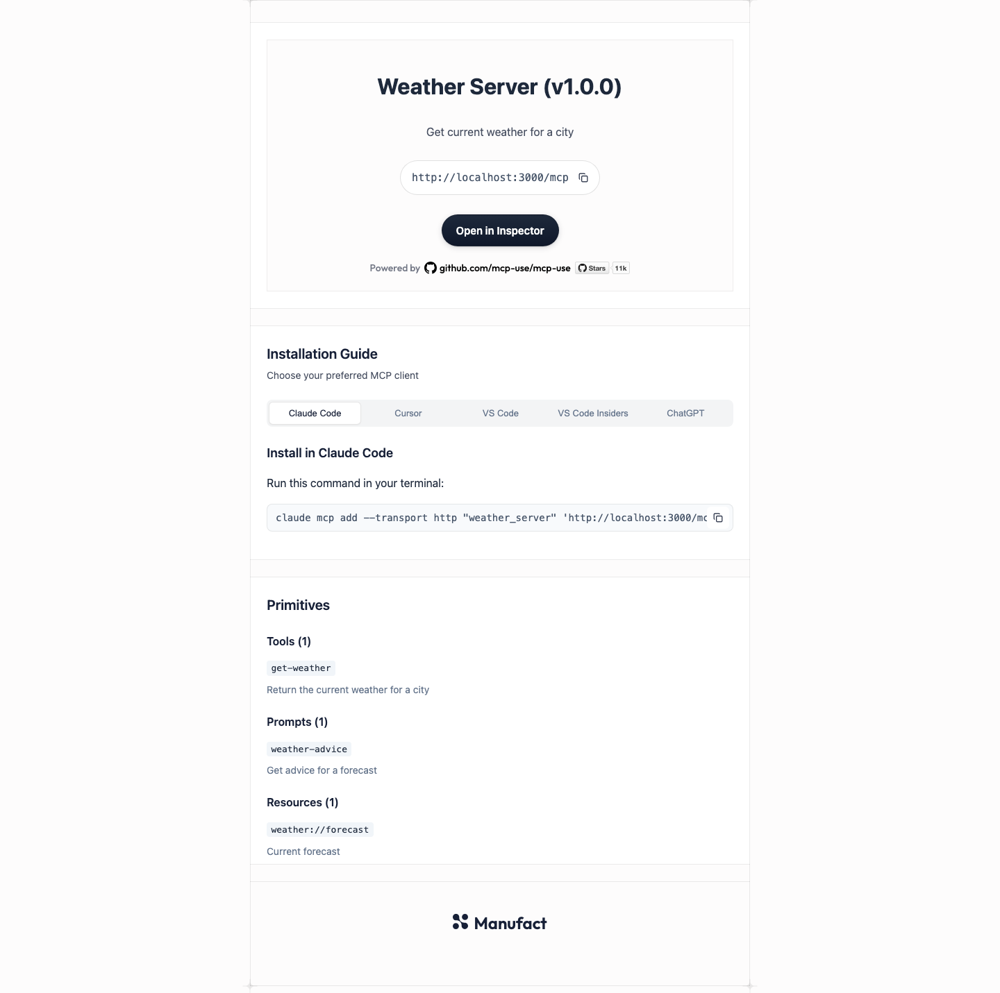

When a browser opens your MCP URL, mcp-use returns an HTML landing page with the server's name, connection instructions for common MCP clients, and its registered capabilities. Add a `landing.tsx` file to your MCP root to replace that page with your own React component. Without `landing.tsx`, mcp-use serves the built-in page.

## When the landing page is shown

mcp-use serves the landing page for `GET` and `HEAD` requests to the MCP URL (such as `http://localhost:3000/mcp`) whose `Accept` header names `text/html`. Browsers send that header when you open the URL. MCP clients do not, so their requests reach the MCP handler as usual.

If the server uses OAuth, the landing page HTML, including the hook data in it, requires a valid bearer token like any other request. Set `publicLandingPage: true` on `MCPServer` to serve it without one. Servers with `mixedAuth: true` already serve it without a token. MCP requests stay protected either way.

The page's compiled JavaScript and CSS under `/_mcp-use/landing/` are always public, so do not put secrets in `landing.tsx`. Read server data through the hooks instead.

The built-in page looks like this for a sample Weather Server with one tool, prompt, and resource:

<Frame>
  
</Frame>

## Create landing.tsx

Projects created with `create-mcp-use-app` already include a `landing.tsx`. It is styled with Tailwind classes and resembles the built-in page. Edit it, or delete it to go back to the built-in page.

To add one to an existing project, put `landing.tsx` next to your server entry:

```text
my-server/
├── index.ts
├── landing.tsx
└── public/
```

The page needs React. Install it if your project does not have it yet:

```bash
npm install react react-dom
npm install --save-dev @types/react @types/react-dom
```

To typecheck the page, set `"jsx": "react-jsx"` in `tsconfig.json` and add `"**/landing.tsx"` to its `include` array.

The default export of `landing.tsx` must be a React component. It returns the page **body content**. mcp-use supplies the HTML document, the `<head>` tags, the favicon, and the hydration script.

```tsx landing.tsx
import {
  useInstallTargets,
  useServerInfo,
  useToolList,
  type LandingMetadata,
} from "mcp-use/landing";

export const metadata: LandingMetadata = {
  title: "Weather for Claude, Cursor, and VS Code",
};

export default function Landing() {
  const { name, title, description, url } = useServerInfo();
  const install = useInstallTargets();
  const tools = useToolList();

  return (
    <main className="mx-auto max-w-2xl space-y-6 p-8">
      <h1 className="text-3xl font-bold">{title ?? name}</h1>
      {description && <p className="text-slate-600">{description}</p>}
      <code className="block rounded bg-slate-100 p-2 text-sm">{url}</code>

      <div className="flex gap-2">
        <a
          href={install.cursor.deeplink}
          className="rounded-full bg-slate-900 px-4 py-2 text-white"
        >
          Add to {install.cursor.label}
        </a>
        <a
          href={install.vscode.deeplink}
          className="rounded-full bg-slate-900 px-4 py-2 text-white"
        >
          Add to {install.vscode.label}
        </a>
      </div>
      <pre className="overflow-x-auto text-sm">
        {install.claudeCode.command}
      </pre>

      <ul className="list-disc pl-5">
        {tools.map((tool) => (
          <li key={tool.name}>{tool.title ?? tool.name}</li>
        ))}
      </ul>
    </main>
  );
}
```

Run `mcp-use dev` and open the MCP URL in a browser to see the page.

For a complete page with client tabs, copy buttons, and a gradient header, start from the [scaffold's `landing.tsx`](https://github.com/mcp-use/mcp-use/blob/canary/docs/v2/typescript/server/examples/landing.tsx).

### Server rendering and hydration

mcp-use renders the component to HTML on the server with React's synchronous `renderToString`, then hydrates it in the browser so state, effects, and event handlers work. Keep browser-only code, such as `window`, `navigator.clipboard`, and event listeners, inside effects and event handlers.

## Read server data with hooks

Import these hooks from `mcp-use/landing` and call them from any component rendered by `landing.tsx`:

| Hook                  | Returns                          | Data                                                                                                  |
| --------------------- | -------------------------------- | ----------------------------------------------------------------------------------------------------- |
| `useServerInfo()`     | `LandingServerInfo`              | Server identity and URLs resolved from the request.                                                   |
| `useToolList()`       | `readonly LandingPageTool[]`     | Registered tools, in registration order.                                                              |
| `usePromptList()`     | `readonly LandingPagePrompt[]`   | Registered prompts, in registration order.                                                            |
| `useResourceList()`   | `readonly LandingPageResource[]` | Registered static resources, in registration order. Resource templates are not included.              |
| `useInstallTargets()` | `InstallTargets`                 | Links and commands that add the server to MCP clients. See [Show install links](#show-install-links). |

Calling a hook outside a component rendered by `landing.tsx` throws `useServerInfo() was called outside the landing page.` (with the hook's name).

`LandingServerInfo` has these fields:

| Field           | Type                  | Meaning                                                                                                                           |
| --------------- | --------------------- | --------------------------------------------------------------------------------------------------------------------------------- |
| `name`          | `string`              | Protocol-facing server name.                                                                                                      |
| `title`         | `string \| undefined` | Human-readable server title. Use `title ?? name` for a heading.                                                                   |
| `version`       | `string`              | Server version reported to MCP clients.                                                                                           |
| `description`   | `string \| undefined` | Server description.                                                                                                               |
| `url`           | `string`              | Absolute URL of the MCP endpoint, resolved from the incoming request.                                                             |
| `websiteUrl`    | `string \| undefined` | The server's configured website.                                                                                                  |
| `iconUrl`       | `string \| undefined` | Absolute favicon URL, when the server configures `favicon` or `icons`.                                                            |
| `iconType`      | `string \| undefined` | MIME type of the favicon, when known.                                                                                             |
| `publicBaseUrl` | `string`              | Absolute URL prefix for files in the project's `public/` directory, ending in `/`. Includes the `MCP_ASSETS_URL` prefix when set. |

Tools and prompts have `name`, an optional `title`, and an optional `description`. Resources have `uri`, and optional `name`, `title`, and `description`.

### Which lists ship to the page

mcp-use writes the hook data into the HTML as JSON so the browser can hydrate. Server info is always included. Each list is included only when your page imports its hook:

- `tools` ships when a module imports `useToolList` from `mcp-use/landing`.
- `prompts` ships when a module imports `usePromptList`.
- `resources` ships when a module imports `useResourceList`.

A page that does not show prompts therefore does not publish them. The CLI finds the imports at build time and in `mcp-use dev`:

- Every module in your `landing.tsx` import graph counts, including modules loaded with dynamic `import()`.
- `import type` does not count.
- A namespace import (`import * as landing from "mcp-use/landing"`) or `export * from "mcp-use/landing"` ships all three lists.
- Imports inside installed packages in `node_modules` do not count. If a component library calls a list hook, also import that hook in your own code.

If a list hook runs on a page that did not ship its list, it throws `useToolList() has no data. Import it in a module under landing.tsx.` (with the hook's name). Import the hook directly from `mcp-use/landing` in one of your modules to fix it.

## Show install links

`useInstallTargets()` returns one entry per client, keyed by client. Each entry has a `label` and one field that depends on how the client installs a server:

| Key              | `label`                | Field                                                              |
| ---------------- | ---------------------- | ------------------------------------------------------------------ |
| `claudeCode`     | `"Claude Code"`        | `command`: a `claude mcp add` command to run in a terminal.        |
| `cursor`         | `"Cursor"`             | `deeplink`: a `cursor://` link that opens Cursor's install prompt. |
| `vscode`         | `"VS Code"`            | `deeplink`: a `vscode:` link that opens VS Code's install prompt.  |
| `vscodeInsiders` | `"VS Code Insiders"`   | `deeplink`: a `vscode-insiders:` link.                             |
| `chatgpt`        | `"ChatGPT"`            | `steps`: plain-text setup steps. ChatGPT has no install link.      |
| `inspector`      | `"Manufact Inspector"` | `url`: the hosted inspector, connected to this server.             |

The keys are in display order. `Object.values(useInstallTargets())` lists the clients in the order of the built-in page's tabs, with Manufact Inspector last. Check which field an entry has to render it:

```tsx
import { useInstallTargets, type InstallTargets } from "mcp-use/landing";

type InstallTarget = InstallTargets[keyof InstallTargets];

function Instructions({ target }: { target: InstallTarget }) {
  if ("command" in target) return <pre>{target.command}</pre>;
  if ("deeplink" in target)
    return <a href={target.deeplink}>Open in {target.label}</a>;
  if ("steps" in target)
    return (
      <ol>
        {target.steps.map((step) => (
          <li key={step}>{step}</li>
        ))}
      </ol>
    );
  return <a href={target.url}>Open {target.label}</a>;
}

export function InstallGuide() {
  return (
    <>
      {Object.values(useInstallTargets()).map((target) => (
        <section key={target.label}>
          <h3>{target.label}</h3>
          <Instructions target={target} />
        </section>
      ))}
    </>
  );
}
```

The built-in page builds its links with the same function, so a custom page and the built-in page always produce the same links.

## Set the page title and preview tags

Export a `metadata` object from `landing.tsx` to set the document `<title>`, meta description, and Open Graph and Twitter tags:

```tsx
import type { LandingMetadata } from "mcp-use/landing";

export const metadata: LandingMetadata = {
  title: "Acme for Claude and Cursor",
  description: "Connect Acme to your AI client in one step.",
  icon: "acme.svg",
  image: "og.png",
};
```

| Field         | Sets                                                                                | Default                                                                           |
| ------------- | ----------------------------------------------------------------------------------- | --------------------------------------------------------------------------------- |
| `title`       | `<title>`, `og:title`, `twitter:title`                                              | The server's `title ?? name`, followed by "MCP Server" and the supported clients. |
| `description` | `<meta name="description">`, `og:description`, `twitter:description`                | The server's `description`, or a generated sentence.                              |
| `icon`        | `<link rel="icon">`                                                                 | The server's favicon, from `favicon` or `icons` on `MCPServer`.                   |
| `image`       | `og:image`, `twitter:image`. Also switches `twitter:card` to `summary_large_image`. | No image, and `twitter:card` is `summary`.                                        |

Every field is optional, and a missing or empty field keeps its default. `icon` and `image` accept an absolute URL or a path in the project's `public/` directory, such as `"og.png"`. mcp-use HTML-escapes every value.

`metadata` must be a plain object. mcp-use reads it once when the module loads, so it cannot change per request. A field that is not a string is ignored, and the server logs a warning that starts with `[mcp-use] landing.tsx metadata:`.

## Style the page

Tailwind classes work in `landing.tsx` with no setup. The page loads the same CLI-managed Tailwind stylesheet as [MCP Apps views](/v2/typescript/mcp-apps). That stylesheet includes Tailwind's preflight reset, which removes browser defaults such as list markers and paragraph margins.

You can also import CSS files. Vite bundles them with the page, and they load after Tailwind, so your rules win where both set a property:

```tsx
import "./landing.css";
```

To use a file from the project's `public/` directory, prefix its path with `publicBaseUrl`:

```tsx
const { publicBaseUrl } = useServerInfo();
return ;
```

### Dark mode

The page sets `data-theme="dark"` or `data-theme="light"` on `<html>` from the visitor's OS color scheme before the first paint, and updates it when the OS setting changes. Tailwind's `dark:` variant follows `data-theme`, so `dark:` classes work with no setup:

```tsx
<main className="bg-white text-zinc-900 dark:bg-zinc-950 dark:text-zinc-100">
```

To add a theme toggle, set `document.documentElement.dataset.theme` yourself. Once the page changes the value, mcp-use stops updating it from the OS.

### Customize Tailwind

To add theme tokens, utilities, or your own `dark` variant, import Tailwind in the page's CSS. You don't need to install `tailwindcss`:

```css landing.css
@import "tailwindcss";

@theme {
  --color-brand: #ff3366;
}
```

When a stylesheet the page imports contains `@import "tailwindcss"`, the page owns Tailwind: mcp-use leaves out its managed stylesheet, so only your copy is compiled. Your `dark` variant, if you define one, is then the only one.

## Develop the page

`mcp-use dev` serves the page with hot reloading:

- **Fast Refresh.** Edits to the component update the open page and keep React state. CSS edits apply immediately.
- **New list hooks.** When an edit imports a list hook the open page did not ship, the page reloads to fetch the new list.
- **Live add and remove.** Creating `landing.tsx` while dev is running switches the open page from the built-in page to yours. Deleting it switches back. Each switch reloads the tab.
- **Last working page.** If an edit breaks the module, for example with a syntax error or a missing default export, mcp-use keeps serving the last version that loaded and logs `[mcp-use] landing update failed; serving last working page` with the error.

## Build and deploy

`mcp-use build` bundles the page with your server into `.mcp-use/build/`, and `mcp-use start` serves the built page. `start` does not look for source files. If you add or remove `landing.tsx`, build again.

In production, mcp-use renders the HTML once for each MCP URL and asset origin and reuses it for later requests.

### Server entry in a subdirectory

mcp-use looks for `landing.tsx` in the MCP root: the project root, or the directory you pass with `--mcp-dir`. The `public/` directory stays at the project root.

```bash
mcp-use dev --mcp-dir src/mcp
mcp-use build --mcp-dir src/mcp
mcp-use start
```

In this example, the page is `src/mcp/landing.tsx`.

### Serve page assets from a CDN

Set `MCP_ASSETS_URL` when you build to load the page's JavaScript and CSS from a CDN. The build rewrites the asset URLs and prints which directory to publish:

```bash
MCP_ASSETS_URL=https://cdn.example.com/acme mcp-use build
```

Publish `.mcp-use/build/landing/` at `<MCP_ASSETS_URL><basePath>/_mcp-use/landing/`, for example `https://cdn.example.com/acme/mcp/_mcp-use/landing/`. With the root `basePath` `/`, the path is `<MCP_ASSETS_URL>/_mcp-use/landing/`. The build log prints the exact URL.

Set `MCP_ASSETS_URL` when the server runs too, so `publicBaseUrl` points at the same CDN. In that case, also publish the project's `public/` directory at `<MCP_ASSETS_URL><basePath>/_mcp-use/public/`. Otherwise `publicBaseUrl` links and the `metadata` `icon` and `image` paths return 404. See the [CLI reference](/v2/typescript/api-reference/cli-reference) for how `MCP_ASSETS_URL` applies to views.

## Use install links on another site

`getInstallTargets()` builds the same install links without a running server, so a docs site or marketing page can show them. `mcp-use/landing` does not import React or Node.js built-ins, so it runs in Node.js, edge runtimes, and browsers.

Pass the MCP URL and the server name. `useInstallTargets()` passes the server's `title ?? name`, so pass the same value to match the links on your landing page:

```tsx app/install/page.tsx
import { getInstallTargets } from "mcp-use/landing";

const install = getInstallTargets({
  url: "https://acme.com/mcp",
  name: "Acme",
});

export default function InstallPage() {
  return (
    <ul>
      <li>
        <a href={install.cursor.deeplink}>Add to {install.cursor.label}</a>
      </li>
      <li>
        <a href={install.vscode.deeplink}>Add to {install.vscode.label}</a>
      </li>
      <li>
        <code>{install.claudeCode.command}</code>
      </li>
    </ul>
  );
}
```

The returned values are not HTML-escaped. JSX escapes them for you, but escape them yourself if you build HTML as a string. If your docs platform cannot import npm packages in a page, run `getInstallTargets()` in a build script and write the values into your docs.
